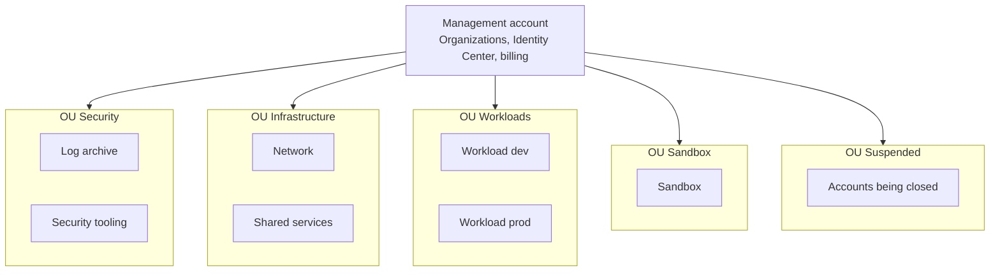

# AWS Landing Zone

A multi-account AWS landing zone written in Terraform. It builds an AWS Organizations foundation with guardrails, centralized identity, logging and security, hub-and-spoke networking, and reusable blueprints to deploy workloads quickly.

The environment is designed to be created and destroyed on demand. Only the foundation, which costs nothing while idle, stays in place between work sessions. Everything billed by the hour is deployed for a session, then destroyed.

## Status

| Phase | Scope | Status |
|---|---|---|
| 0. Bootstrap | Terraform state backend, GitHub Actions OIDC roles, CI checks | In progress |
| 1. Governance | Organizational units, account factory, SCPs and RCPs, IAM Identity Center | Planned |
| 2. Security | Organization trail, AWS Config, GuardDuty, Security Hub, account baseline | Planned |
| 3. Networking | IPAM, Transit Gateway, centralized egress, segmentation, private DNS, site-to-site VPN | Planned |
| 4. Workload blueprints | Static website, serverless API, ECS on Fargate with RDS, EKS with Argo CD | Planned |
| 5. Hardening | Terraform tests, cost estimates in pull requests, drift detection, scheduled destroy | Planned |

This table is the source of truth: a component is described as a feature only once its phase is done.

## Target architecture



The account structure follows the AWS Security Reference Architecture. The management account only governs (organization, identities, billing) and never hosts workloads. Logs and security tooling live in dedicated accounts, so that a compromised workload account cannot erase its own traces.

## Design principles

- **Accounts are the isolation boundary.** Environments and functions are separated by account, not by naming conventions inside a shared account.
- **No long-lived credentials.** People sign in through IAM Identity Center and CI authenticates through OIDC. No IAM user or access key exists.
- **One configuration file per deployment.** `config/landing-zone.yaml` describes the organization, regions and options. Adapting the landing zone to a new context means editing that file, not the code.
- **Lifecycles drive the layout.** Persistent free layers and ephemeral billed layers live in separate stacks with separate states, so the expensive parts can be destroyed without touching the foundation.
- **Decisions are written down.** Every structuring choice is recorded as an Architecture Decision Record in `docs/adr/`.

## Repository layout

```text
.
├── bootstrap/           Applied once from a workstation: state bucket and CI roles
├── config/              landing-zone.yaml, the single file to adapt per deployment
├── docs/adr/            Architecture Decision Records
├── modules/             Reusable modules (from phase 1)
├── stacks/              Root modules, one state each, applied in order by CI (from phase 1)
└── .github/workflows/   CI checks and an OIDC trust check (plan and apply pipelines from phase 1)
```

## Getting started

Prerequisites, tool versions and the step-by-step procedure are in [bootstrap/README.md](bootstrap/README.md).

## Cost

The foundation (AWS Organizations, IAM Identity Center, service control policies, the state bucket) costs nothing while idle. Components billed by the hour, such as NAT gateways, Transit Gateway attachments or an EKS control plane, are deployed for a work session and destroyed afterwards. Budget alerts with a low threshold catch anything left running.

## Architecture decisions

| ADR | Decision |
|---|---|
| [0001](docs/adr/0001-multi-account-native-terraform.md) | Build the landing zone in Terraform directly on AWS Organizations, without Control Tower at first |
| [0002](docs/adr/0002-terraform-state-in-s3-with-native-locking.md) | Store every Terraform state in one S3 bucket with native locking, one state per stack |
| [0003](docs/adr/0003-github-actions-oidc-with-split-roles.md) | Authenticate GitHub Actions through OIDC, with separate plan and apply roles |

## License

[MIT](LICENSE)
